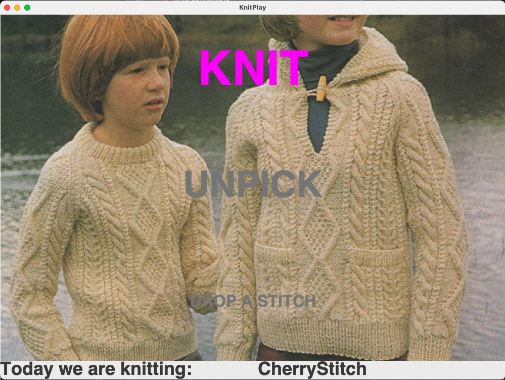

# KnitPlay

**An experimental Java application that translates knitting patterns into sound.**

KnitPlay is a software artwork originally developed in 2020 as part of my MSc Software Development at the University of Glasgow.

The project explores the relationship between traditionally feminine crafts, computer programming and electronic music, drawing on the histories of women working with machines, textiles and technology.

It began with an interest in using computer programming as a creative medium, rather than simply as a tool for solving practical problems. Knitting patterns offered an interesting starting point: they are, in essence, algorithms — sets of instructions that can be followed to produce a particular result.

KnitPlay interprets these instructions computationally, modelling the structure of knitted fabric as a graph and using the processes of knitting, unpicking and dropping stitches to generate sound.

The resulting soundscapes draw inspiration from Scottish Highland waulking songs, traditionally sung by women working cloth, alongside recordings of knitting needles and other sounds.



## How it works

The application reads knitting patterns written in *KnitSpeak*, a notation describing the stitches and operations needed to produce knitted fabric.

These instructions are interpreted to construct a **KnitGraph**, a graph data structure in which stitches are represented as nodes and the connections between them as edges.

Three principal algorithms simulate the processes of:

- **Knitting** — constructing the graph by adding stitches and their connections.
- **Unpicking** — reversing the knitting process by removing stitches.
- **Dropping a stitch** — following the relationships between stitches to determine which stitches unravel and updating the graph accordingly.

Each stitch is associated with a sound. As the graph is constructed and modified, sounds are triggered in response to these processes. Once knitting is complete, the resulting graph can be played back as a sound composition.

The application was developed using Java, Swing, multithreading, graph data structures and the Java Sound API.

## Download and run

**Requirements:** Java 17 and a computer capable of running Java Swing applications and playing audio.

1. Download `KnitPlay.zip` from the [GitHub Releases](../../releases) page.
2. Extract the ZIP file.
3. Open a terminal and navigate into the extracted `KnitPlay` directory.
4. Run:

   ```bash
   java -jar KnitPlay.jar
   ```

Keep the `images`, `sounds` and `knitSpeak` folders alongside `KnitPlay.jar`, as the application requires these resources to run.

## Build from source

Clone the repository and navigate into its directory.

Compile the application using JDK 17 or newer:

```bash
mkdir -p build/classes

javac --release 17 -d build/classes \
  KnitPlay.java \
  KnitGraph.java \
  KnitFileSelector.java \
  KnitSpeakIn.java \
  SoundPlayer.java
```

Run the compiled application:

```bash
java -cp build/classes KnitPlay
```

Alternatively, create an executable JAR:

```bash
jar --create \
  --file build/KnitPlay.jar \
  --main-class KnitPlay \
  -C build/classes .
```

Run it from the repository root:

```bash
java -jar build/KnitPlay.jar
```

## Tests

The project includes JUnit 5 tests in `KnitGraphTest.java`, covering knitting, unpicking and dropped-stitch behaviour.

The tests can be run using an IDE with JUnit 5 support or the JUnit Platform Console Launcher.

Download `junit-platform-console-standalone-1.13.4.jar` from Maven Central and place it in a `lib/` directory in the project root.

Compile the tests:

```bash
mkdir -p build/test-classes

javac --release 17 \
  -cp "build/classes:lib/junit-platform-console-standalone-1.13.4.jar" \
  -d build/test-classes \
  KnitGraphTest.java
```

Run the tests:

```bash
java -jar lib/junit-platform-console-standalone-1.13.4.jar \
  execute \
  --class-path build/classes:build/test-classes \
  --select-class KnitGraphTest
```

These tests exercise the application's graphical and audio functionality and may take several minutes to complete.

## Project documentation

The original MSc dissertation, *Playing Knit Graphs* (2020), documents the research, technical design, algorithm development, testing and evaluation of the project.

[Read the original dissertation (PDF)](docs/Playing_Knit_Graphs_2020.pdf)

It includes illustrations of the KnitGraph data structure, explanations of the algorithms and reflections on the relationship between programming, creative practice and traditionally feminine crafts.

## Project history

KnitPlay was originally developed in 2020 using Java and Eclipse.

In 2026, the project was restored and updated for compatibility with Java 17, including changes to resource handling, documentation and JUnit tests, while retaining the original architecture and creative approach.

The application remains an experimental software artwork rather than a general-purpose knitting pattern interpreter. It supports a selected set of knitting instructions and patterns.
